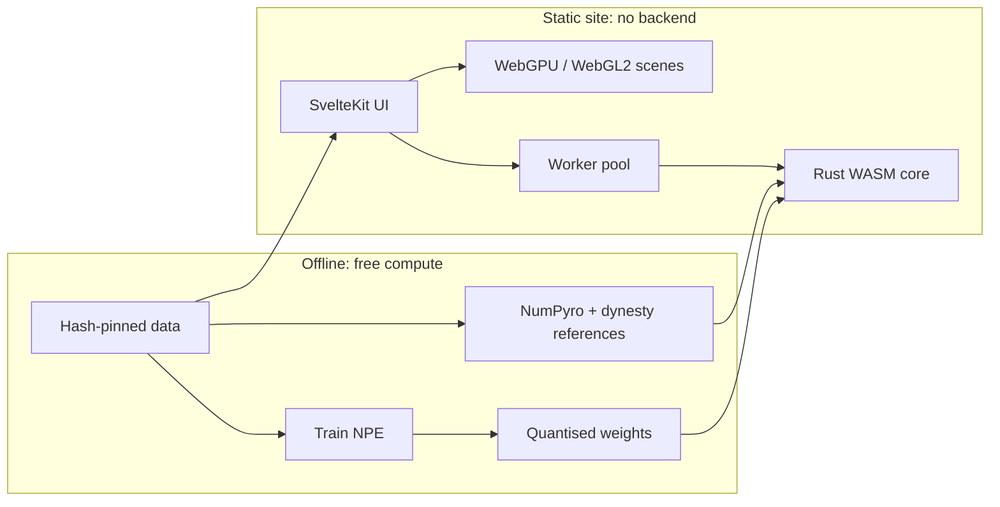

# Band-Gap Observatory

**A browser-native, zero-backend inference and experiment-design instrument for an undergraduate diode-thermometry dataset.**

[](https://github.com/JoeyHammoth/semiconductor-bandgap-belvedere/actions/workflows/ci.yml)
[](https://github.com/JoeyHammoth/semiconductor-bandgap-belvedere/actions/workflows/deploy.yml)
[](LICENSE)

**Live:** https://joeyhammoth.github.io/semiconductor-bandgap-belvedere/ — Phase 0 walking skeleton. The real dataset is not published yet (the original logs are still being recovered), so the site runs on labelled literature parameters.

## The question

> *Given a real, imperfect measurement, how much do we actually know about the band gap, which assumptions does the data support, and what should we measure next?*

An undergraduate lab measures a diode's forward voltage as a Peltier stage sweeps its temperature, then fits a straight line and calls the intercept the band gap. That analysis quietly assumes an ideal diode, a temperature-independent prefactor, no series resistance and no sensor lag. This project tests those assumptions against the data and reports which ones the data actually support.

The most interesting result may be negative: over a 60–100 K window around room temperature, `E_g`, `ln B` and the prefactor exponent are nearly collinear, so the intercept is a mixture of them rather than the band gap alone. The instrument shows that degeneracy, then recommends the measurement that would break it.

## What it will do

| | Scene | What you see |
|---|---|---|
| S0 | **The Gap** | An electron sea separated by the temperature-dependent gap; thermal excitation and photon emission in the diode's real colour |
| S1 | **The Noisy Line** | The lab's straight line, then 500 posterior lines, then the posterior predictive band |
| S2 | **Shrinking Light** | Nested-sampling live points contracting while `ln Z` accumulates |
| S3 | **The Swarm** | Stein-variational particles flowing into the posterior, compared with MCMC |
| S4 | **Sloppiness** | A Fisher ellipsoid thin as a needle, and a temperature-range slider that thickens it |
| S5 | **Morph** | Posterior particles transported from the lab model to the full model |
| S6 | **Thermal Twin** | Latent junction temperature, sensor lag, and data-driven time constants |
| S7 | **Crystal to Colour** | Band structure and DOS for Si/Ge, an LED rendered in its emitted colour, CIE diagram |
| S8 | **Next Measurement** | Expected-information-gain terrain and a "you versus the designer" game |
| S10 | **Evidence Ledger** | `ln Z`, Bayes factors, PSIS-LOO, prior sensitivity, and a plain-language verdict |

Each scene ships with an accessible table and a static, reduced-motion equivalent.

## What is and is not novel

**Not novel:** measuring a band gap from diode thermometry (Collings 1980; Precker and da Silva 2002), the Shockley equation, Varshni's relation, MCMC, nested sampling or neural posterior estimation. The site claims no new physics and no better band gap than the literature.

**The contribution** is the combination: a real, imperfect measurement interrogated by sloppy-model analysis, microcanonical HMC, nested-sampling evidence, Stein variational inference, optimal transport, state-space models and amortised posteriors — every number validated, every visual tied to a computation, all running client-side on a free static host.

## Architecture



- **Rust workspace** (`crates/bgo-*`): physics, autodiff, samplers, Fisher information, optimal transport, state space, flow engine, band structure, WASM surface.
- **SvelteKit** (`web/`): adapter-static, base-path aware, prerendered shell, lazy scenes.
- **Python** (`train/`): simulator, NPE training, reference posteriors, exports.
- **No server, no database, no paid API, no `SharedArrayBuffer`.** Details in [`docs/architecture.md`](docs/architecture.md).

## Quickstart

```bash
# Web shell
cd web
npm ci
npm run dev            # http://localhost:5173
npm run check
npm run build          # static output in web/build

# Rust workspace
rustup target add wasm32-unknown-unknown
cargo test --workspace

# Build the WASM core into the site
RUSTFLAGS="-C target-feature=+simd128" \
  wasm-pack build crates/bgo-wasm --release --target web --out-dir ../../web/static/wasm
```

The Rust toolchain is not installed on every development machine; CI builds and tests the workspace regardless.

## Repository map

```text
crates/       Rust workspace: physics, inference, information geometry, OT, SSM, NN, EPM, WASM
web/          SvelteKit static site: engine, scenes, UI, state
train/        Python: simulator, NPE training, reference posteriors, exports
data/         Raw and cleaned runs, JSON Schema, hash manifest
docs/         Model, architecture, validation, accessibility, licences, data, ADRs
source/       Immutable input material: lab report, handout, design document
scripts/      Size budgets, data hashing, releases
```

## Validation

Nothing ships on trust. Each claim has a test, a tolerance and a committed artifact in [`docs/validation.md`](docs/validation.md). Current headline targets:

| Claim | Status |
|---|---|
| M0 reproduces the report's Table 1 intercepts | pending |
| MCLMC matches NumPyro NUTS on M0–M4 | pending |
| Nested-sampling `ln Z` matches closed form and `dynesty` | pending |
| Neural posterior passes SBC and TARP | pending |
| Accessibility and size budgets enforced in CI | verified (CI) |

Status values are honest: **pending** means the test does not exist yet.

## Roadmap

Eight phases; the MVP is v0.1.0 at the end of Phase 3.

| Phase | Ships |
|---|---|
| 0 | Walking skeleton: repo, CI/CD, Pages, tokens, data audit |
| 1 | Physics, AD, MCLMC, hero and noisy-line scenes |
| 2 | Nested sampling, sloppiness, swarm, evidence ledger |
| 3 | Neural posteriors, calibration, PWA, **v0.1.0** |
| 4 | Thermal twin: UKF/RTS, GP discrepancy, DMDc |
| 5 | Experiment design and optimal transport |
| 6 | Band structure, DOS, LED colour, Bose–Einstein evidence |
| 7 | Tour, share card, cross-browser, stretch goals |

Issues and acceptance criteria live in the [project board](https://github.com/users/JoeyHammoth/projects/4) and in [`docs/roadmap.md`](docs/roadmap.md).

## Free-tier constraints that shaped the design

GitHub Pages on a free plan cannot set COOP/COEP headers, so there is no `SharedArrayBuffer` or WASM threading: parallelism is several workers with separate WASM instances. The repository must be public. LFS is not served, so datasets and weights are small plain files. Budgets: initial route ≤ 150 KB JS, core WASM ≤ 700 KB gzip, total site ≤ 60 MB. The full table is in [`docs/architecture.md`](docs/architecture.md#8-budgets).

## Data and attribution

The measured runs come from a PHYC30021 lab report. Publication consent has been granted with attribution; the five original logs have not yet been supplied, so the public site runs in simulator mode until they are audited and hash-pinned. See [`docs/data.md`](docs/data.md). The MIT licence covers the code and original writing, not the dataset, the report text or its figures.

## Documentation

| Document | Contents |
|---|---|
| [`docs/model.md`](docs/model.md) | normative physics and statistical model |
| [`docs/architecture.md`](docs/architecture.md) | boundaries, worker protocol, budgets, deployment |
| [`docs/validation.md`](docs/validation.md) | claims, tests, tolerances, evidence |
| [`docs/physics-audit.md`](docs/physics-audit.md) | what the lab numbers actually mean (open) |
| [`docs/data.md`](docs/data.md) | provenance, schema, units, known issues |
| [`docs/a11y.md`](docs/a11y.md) | WCAG 2.2 AA commitments and testing |
| [`docs/licences.md`](docs/licences.md) | asset and dependency licence register |
| [`docs/roadmap.md`](docs/roadmap.md) | phases, tasks, definition of done |
| [`docs/adr/`](docs/adr/) | architectural decision records |
| [`GLOSSARY.md`](GLOSSARY.md) | shared vocabulary |
| [`CONTRIBUTING.md`](CONTRIBUTING.md) | workflow and engineering rules |

## Licence

MIT for code and original writing — see [`LICENSE`](LICENSE). Third-party assets and their terms are listed in [`docs/licences.md`](docs/licences.md).
