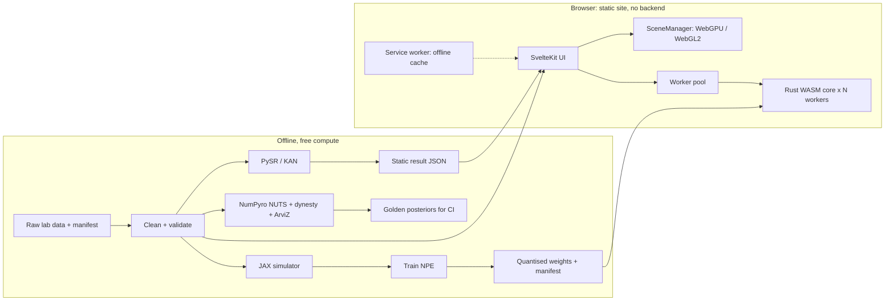

# Architecture

The site is a static SvelteKit application on GitHub Pages with no backend, no database and no paid service. All inference runs client-side: Rust compiled to WebAssembly in a small pool of Web Workers, with GPU work reserved for visuals and particle inference.

## 1. System overview



The raw-data path is retained for a future authentic recovery. No runs exist today, so the site uses labelled simulations and the report summary; see [ADR 0006](adr/0006-no-recorded-dataset.md).

## 2. Repository layout

```text
crates/                      Rust workspace, no server-only dependencies
  bgo-physics/               diode, Varshni, Bose–Einstein, Lambert W, CIE colour, units
  bgo-ad/                    dual and hyper-dual numbers
  bgo-infer/                 MCLMC, nested sampling, SVGD, Laplace, diagnostics
  bgo-info/                  Fisher, Cramér–Rao, D-optimal, EIG, sloppy spectrum
  bgo-ot/                    Sinkhorn, sliced Wasserstein, displacement interpolation
  bgo-ssm/                   UKF, RTS, Matérn-3/2 state, Hankel-DMDc, SVD
  bgo-nn/                    flow inference engine (MLP + rational-quadratic spline)
  bgo-epm/                   EPM Hamiltonian, tridiagonal QL/Lanczos, DOS, KPM
  bgo-wasm/                  wasm-bindgen surface, typed-array I/O
web/                         SvelteKit app, adapter-static
  src/lib/engine/            worker pool, protocol, WASM loader
  src/lib/scenes/            S0..S10, one module per scene
  src/lib/ui/                tokens, components, status bar, command palette
  src/lib/state/             runes stores, URL-hash permalinks, IndexedDB
  src/routes/                /, /infer, /twin, /explore, /design, /ledger, /about
  src/service-worker.ts
  static/{wasm,weights,data}/
train/                       Python: simulator, NPE training, references, export
data/                        raw/, clean/, schema.json, manifest.json
docs/                        model, architecture, validation, accessibility, licences, ADRs
scripts/                     budgets, data validation, release helpers
.github/workflows/           ci.yml, deploy.yml, refs.yml
```

The Rust workspace deliberately has no heavyweight linear-algebra dependency: the dense symmetric solves, Cholesky, SVD and tridiagonal eigensolvers the project needs are short enough to own, and owning them keeps the WASM payload inside budget.

## 3. Boundaries

| Boundary | Contract | Why it is where it is |
|---|---|---|
| Web ↔ worker | `postMessage` request/response, typed arrays as transferables | no `SharedArrayBuffer` on GitHub Pages |
| Worker ↔ Rust | `wasm-bindgen` functions taking/returning `Float64Array` views | avoids per-element marshalling |
| Offline ↔ site | committed JSON, weights and golden vectors with hashes | no backend, reproducible |
| Scenes ↔ engine | scene asks for numbers, never computes physics itself | every visual traces to a computation |

The worker protocol is defined once in `web/src/lib/engine/protocol.ts` and mirrored by the `bgo-wasm` exports. Adding a message kind is a two-file change plus a test.

## 4. Worker architecture

- The main thread compiles the WASM module once with `WebAssembly.compileStreaming` and transfers the compiled `WebAssembly.Module` to each worker.
- Pool size: `min(hardwareConcurrency − 1, 4)`, 2 on mobile.
- Cancellation terminates and respawns the worker; WASM loops are not interruptible. No listener leaks, no stale results.
- Progress streams as `postMessage` events; large arrays are transferred, not cloned.
- Seeds are deterministic and part of the URL state, so any view can be re-run exactly.

## 5. State and permalinks

Full view state (model, dataset id, slider values, seeds) is serialised to the URL hash: CBOR → deflate (`fflate`) → base64url. Heavy results are cached in IndexedDB keyed by content hash. A permalink is a first-class artefact: the share card embeds a QR code generated client-side.

## 6. Rendering and degradation

three.js with `WebGPURenderer`/TSL when available, automatic WebGL2 otherwise. A single `SceneManager` owns the device and a shared rAF loop; scenes mount through `IntersectionObserver` and pause on the Page Visibility API. A frame-time governor adapts particle counts and render scale.

| Capability | Preferred | Fallback 1 | Fallback 2 |
|---|---|---|---|
| Hero (S0) | WebGPU compute particles | WebGL2 stateless particles | pre-rendered poster + static diagram |
| SVGD (S3) | WebGPU kernel sums | WASM pairwise (n ≤ 256) | precomputed trajectory replay |
| 3D scenes | WebGPURenderer | WebGL2 | 2D SVG diagrams |
| Band structure | CPU worker (EPM) | fewer k-points | precomputed bands |
| Inference | Rust MCLMC in workers | fewer chains/samples | precomputed posteriors |

The core story and every number remain available on every path. Feature detection happens at load and the status bar names the active path.

## 7. Deployment

GitHub Pages, source "GitHub Actions", base path `/semiconductor-bandgap-belvedere`. `static/.nojekyll` is required. Pages serves `.wasm` with the correct MIME type, so streaming instantiation works.

```bash
BASE_PATH=/semiconductor-bandgap-belvedere npm run build   # in web/
```

`deploy.yml` publishes only from `main`; pull requests build and test without deploying. The output is plain static files, so the same build deploys to Cloudflare Pages or Netlify by clearing `BASE_PATH` and adding a `_headers` file.

## 8. Budgets

| Asset | Budget (gzip) |
|---|---|
| Initial route HTML + JS + CSS | ≤ 150 KB JS, ≤ 30 KB CSS |
| Hero scene (S0) code + shaders | ≤ 60 KB |
| Core WASM (lazy) | ≤ 700 KB |
| NPE weights (lazy) | ≤ 700 KB |
| three.js tree-shaken bundle (lazy) | ≤ 250 KB |
| Fonts (subset woff2, total) | ≤ 150 KB |
| Datasets (all runs) | ≤ 2 MB |
| **Total published site** | **≤ 60 MB** (hard ceiling 200 MB) |

`scripts/size-budget.mjs` enforces these in CI. Runtime targets: LCP under 2.5 s on a fast connection and a mid-range phone, instant inference under 100 ms, MCLMC on M0–M2 under 10 s, hero at 30+ fps with adaptive scaling.

## 9. Invariants

1. No server, database, account system or paid API at any stage.
2. No `SharedArrayBuffer`, no COOP/COEP requirement, no `coi-serviceworker` hacks.
3. Every published number traces to code, a cited source or a hash-pinned dataset, and a commit.
4. Physics lives in Rust crates, never in scene code.
5. Datasets and weights are plain files in git, each well under 10 MB, never LFS.
6. The public site never connects to hardware or commands an actuator.
7. If a diagnostic fails, the UI must not show a "converged" badge.

## 10. Decisions

See [`docs/adr/`](adr/): static site, MCLMC in the browser, hand-written flow engine, CPU band structure, worker parallelism without shared memory, and the lost-dataset decision.
