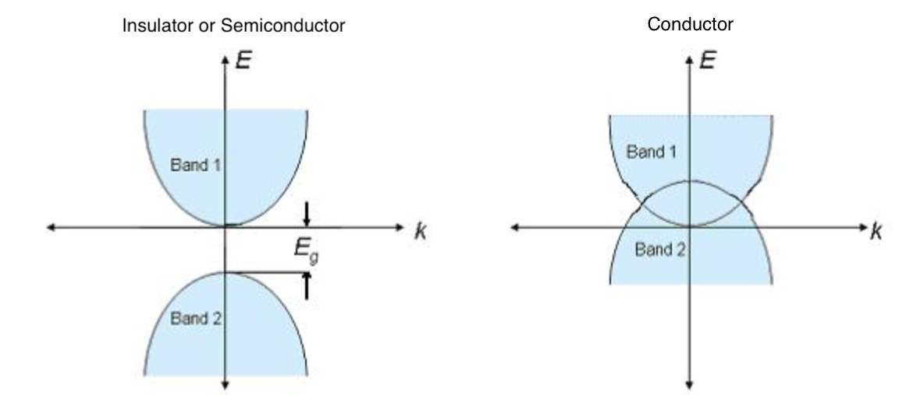
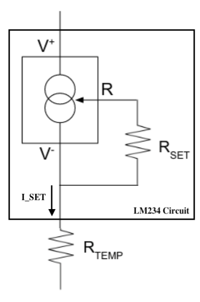
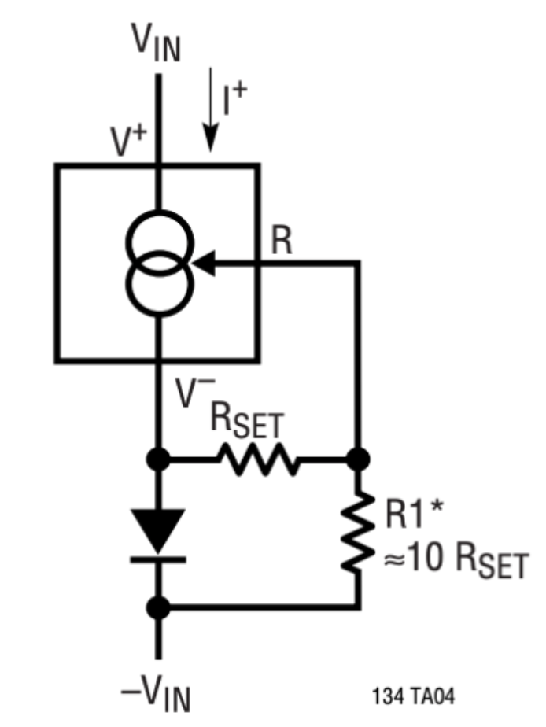
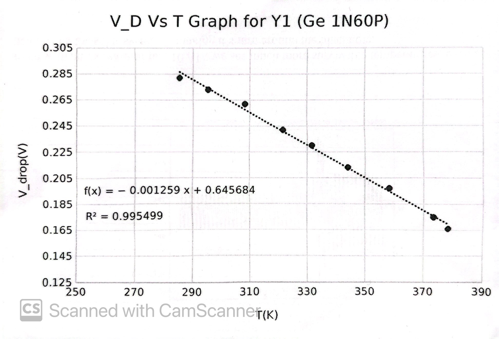

:::::: multicols
2 \[

# Abstract {#abstract .unnumbered}

The band-gap energy is a physical property of a semiconductor that is
used to characterize different types of semiconductors which allows for
different use cases such as LEDs and solar cells among others. It is
computed using an analog-to-digital converter controlled by a Raspberry
PI and a constant current source circuit. The voltage drop is measured
using these apparatuses as temperature changes, where the energy can be
computed using Shockley's diode equation. The wavelength of visible
light emitted by LEDs is calculated using the band-gap energies and
Planck's equation. Measured band-gap energies and wavelengths for the
chosen diodes are all consistent with the expected values from
established sources. The negative relationship between band-gap and
temperature of a semiconductor is established through these results.\

------------------------------------------------------------------------

\]

# Introduction

Semiconductors are materials with an electric conductivity ranging
between that of an insulator and a conductor [@electricity-magnetism].
But the range of conductive behaviour that different semiconductor
materials could display is quite vast and could be used for different
applications. Generally, the band-gap energies of these materials are
used to characterize this conductivity. The band gap of a semiconductor
is the energy required to promote an electron from the valence band to
the conduction band which will be denoted as $E_g$. The band gap is
dependent on temperature and there generally is a negative relationship
between both variables caused by thermal vibrations [@Precker2002].
$E_g$ can be expressed as the following:

$$\begin{equation}
\label{1}
    E_g(T) = E_g(0) - \frac{\alpha{T^2}}{T+\beta}
\end{equation}$$

where $E_g(0), \alpha$ and $\beta$ are properties of the material while
T is the temperature in kelvin. The band gap can be visualized in an
energy-density of states graph as seen below. An electron needs enough
energy to jump from the valence band to the conduction band which is
separated by the band-gap. The width of the gap decreases as the
material acts more like a conductor.

<figure id="fig_1" data-latex-placement="H">

<figcaption>
General energy vs. density of states plots for an
insulator/semiconductor and conductor, where band 1 is the conduction
band, and band 2 is the valence band.</figcaption>
</figure>

A diode allows for electric current to pass in one direction while
blocking the opposite. It typically consists of a semiconductor crystal
that contains a p-n junction which is where a region of the material
that contains an excess of electrons is placed together with a region
that contains a deficit of electrons, causing current to flow in only
one direction. Semiconductor materials do not obey Ohm's law, but
instead obey the Shockley diode equation. The following simplified
expression will be used [@6773080]:

$$\begin{equation}
\label{2}
    I \approx I_s{e^{\frac{qV_D}{kT}}}
\end{equation}$$

where the I is the current of the diode, $I_s$ is the reverse saturation
current, q is the charge of an electron, k is the Boltzmann constant and
$V_D$ is the drop voltage across the diode. $I_s$ is expressed as the
following:

$$\begin{equation}
\label{3}
    I_s = Be^{\frac{-E_g}{kT}}
\end{equation}$$

where B is a constant of the material. Using equations
([\[2\]](#2){reference-type="ref" reference="2"}) and
([\[3\]](#3){reference-type="ref" reference="3"}), an expression for
voltage drop can be formulated as the following:

$$\begin{equation}
\label{4}
    V_D{(T)}=(\frac{k \ln(\frac{I}{B})}{q})T + \frac{E_g}{q}
\end{equation}$$

Using these equations and a few measuring apparatuses, the band-gap
width of various diodes will be measured and compared with existing
sources. Section two will introduce these apparatuses and methods
involved in measuring the variables needed to compute the band-gap
energy. Section 3 outlines the results and how they compare with
expected values taken from established literature. Section 4 includes a
discussion of these results and some limitations and improvements of the
methods involved and section 5 concludes and summarizes the overall
findings.

# Methodology

## Analog to Digital Converter (ADC)

To measure the voltage across a diode, an Analog to Digital Converter
(ADC) is used that is controlled by a raspberry PI (RPi). This converter
acts as a multi-meter, where it connects to various points in a circuit
and measure the relevant quantities at these locations by converting an
analog to digital signal that can be read by the RPi
[@ads1115-datasheet].

## Constant Current Source (CCS)

In order for ([\[4\]](#4){reference-type="ref" reference="4"}) to hold,
a diode needs to be fed by a constant current. To achieve this, an LM234
component is used to maintain a constant flow of current in a circuit
[@LM134-datasheet].

<figure id="fig_2" data-latex-placement="H">
<figure id="fig_2a">

<figcaption>Setup of a general constant current source.</figcaption>
</figure>
<figure id="fig_2b">

<figcaption>Setup of a modified constant current source that is used to
measure the drop voltage across a diode.</figcaption>
</figure>
<figcaption>Two diagrams of constant current source
circuits.</figcaption>
</figure>

$V^+$, $V^-$ and R represent the pins of the LM234 component which is
represented as two intersecting circles in the above schematic. Based on
the resistance of $R_{set}$, the LM234 component will constrict the flow
of current from $V^+$, creating a constant flow of current to pass. The
$R_{temp}$ resistor is used to measure the current $I_{set}$ of the
LM234 circuit using Ohms law where $I_{set} = \frac{V}{R_{temp}}$. The
voltage passing through the circuit is the variable of interest and will
be used to measure the band-gap energy using equation
([\[4\]](#4){reference-type="ref" reference="4"}) as the temperature of
the semiconductor changes. This change in temperature is facilitated by
a peltier device which is used to convert electrical energy into a
temperature differential, allowing for the heating and cooling of the
material. A multimeter with a thermocouple attachment is used to measure
the temperature of the peltier.

The circuit that will be used for this measuring the drop voltage across
a chosen diode is a modification of figure
[2](#fig_2a){reference-type="ref" reference="fig_2a"} which is shown in
figure [3](#fig_2b){reference-type="ref" reference="fig_2b"}. The
introduction of $R_1$ allows for temperature compensation, allowing the
current to be independent of ambient temperature. This results in a
direct relationship between voltage drop and temperature without having
to take into account the effect temperature with current. Note that this
circuit is still connected to the $R_{temp}$ resistor and the figure
only displays the modified LM234 circuit by itself. Using Ohm's law to
compute the voltage drop is still consistent for this set-up.

## Drop Voltage Measurements

Five different semiconductors are measured for their band-gap energies.
They include a germanium diode, silicon diode, red LED, blue LED and
green LED. The voltage drop of the diodes are measured using the CCS
circuit where arbitrarily, $R_{set} = 220\Omega$, $R_{set} = 2200\Omega$
and $R_{temp} = 150\Omega$.

At higher temperatures, the simplified expression
([\[2\]](#2){reference-type="ref" reference="2"}) does not hold since
the original Shockley equation contains a negative $I_S$ term. Thus, for
this simplification to be accurate, the value of $e^{\frac{qV_D}{kT}}$
needs to be much bigger relative to 1. As temperature increases, this
exponential term decreases, causing the approximation to be less
accurate. As such, a temperature limit of $383.15K$ is used to allow
this expression to hold.

Starting from an arbitrary low temperature, a program on the RPi is run
which tells the ADC to measure the current ($I_{Set}$) of the LM234
circuit. The RPi then computes the voltage drop using Ohms law. During
this process of measurement and recording, the peltier device is
temporarily stopped, allowing minimal change in temperature during that
time. This process repeats until an arbitrarily high temperature is
reached. The number of total data points recorded along with their
temperatures are arbitrarily chosen for each diode due to the
sensitivity of the thermocouple.

# Results and Analysis

Five plots were processed using the recorded data. The following is a
plot generated from the voltage drop data from the germanium diode.

<figure id="fig_3" data-latex-placement="H">

<figcaption>A plot outlining the voltage drop and temperature
relationship of a germanium diode with instrument uncertainty
introduced.</figcaption>
</figure>

The negative relationship between the temperature of the diode and the
voltage drop across it is apparent from the plot and is consistent
throughout all the diodes. This relationship is expected considering the
simplified Shockley equation ([\[2\]](#2){reference-type="ref"
reference="2"}). By using the y-intercept of each plot for all the five
diodes, it is possible to compute the energy band-gap in accordance with
([\[4\]](#4){reference-type="ref" reference="4"}). The following
band-gap values along with their uncertainties computed using max-min
trend lines are shown below for all 5 diodes.

::: center
        Diode        $E_g$ (eV)   $\delta(E_g)$ (eV)
  ----------------- ------------ --------------------
   Germanium Diode     0.646            0.0071
    Silicon Diode      1.002            0.0113
       Red LED         2.030            0.0120
      Blue LED         2.796            0.0126
      Green LED        2.303            0.0112
:::

Comparing these results with the expected results for the energy
band-gap in these diodes using values from the American Journal of
Physics [@Collings1980]:

::: center
  Diode             Measured $E_g$ (eV)   Expected $E_g$ (eV)   Percentage Error (%)
  ----------------- --------------------- --------------------- ----------------------
  Germanium Diode   0.646                 0.67                  3.58
  Silicon Diode     1.002                 1.12                  10.54
  Red LED           2.030                 1.97                  3.05
  Blue LED          2.796                 2.67                  4.72
  Green LED         2.303                 2.30                  0.13
:::

The wavelengths of the visible light emitted by the LEDs can be computed
using Plancks equation $\lambda = \frac{hc}{E_g{q}}$. The following
table compares these results with the expected value from The Physics of
Semiconductor Devices [@sze1969physics]:

::: center
  LED     Measured $\lambda$ (nm)   Expected $\lambda$ (nm)   Percentage Error (%)
  ------- ------------------------- ------------------------- ----------------------
  Red     613                       630                       2.70
  Blue    444                       465                       4.52
  Green   539                       530                       1.70
:::

The values of $E_g$ can be denoted as $E_g (0)$, which in accordance
with ([\[1\]](#1){reference-type="ref" reference="1"}) can be used to
determine the band-gap energy at any temperature when the values for
$\alpha$ and $\beta$ (which are properties of the material) are
provided.

# Discussion

The negative relationship that is present in all of the voltage drop and
temperature plots for the five diodes is in accordance with the how the
band-gap in a semiconductor generally decreases with increasing
temperature as atomic thermal vibration increases. This is because, when
an increase in T results in a decrease in $V_D$,
([\[4\]](#4){reference-type="ref" reference="4"}) implies that the
y-intercept or $\frac{E_g}{q}$ term must decrease since it is the only
term responsible for the decrease in $V_D$ (because a modified CCS is
used, current is not dependent on ambient temperature). Therefore, the
results confirms the established relationship between the band-gap
energy and temperature of a semiconductor.

All the measured value for $E_g$ are accurate and well withing
expectation when comparing with expected values from established
literature, with the highest error percentage being 10.54%.
Uncertainties are also relatively low. Most of these uncertainties and
errors are caused by the sensitivity of the thermocouple when measuring
temperature. This could be amended by using the original LM234 set-up
that is sensitive to temperature. For this set-up, the expression
$T = \frac{I_{set}R_{set}}{\gamma}$ ($\gamma \approx 227\mu VK^{-1}$ at
$293 K$) can be used to simultaneously measure the temperature and
voltage drop, abandoning the need for an inaccurate thermocouple and
avoiding any temperature changes that occurs during measurement.
However, this results in the need to modify
([\[4\]](#4){reference-type="ref" reference="4"}) since the current is
now dependent on temperature. This complicates the process of computing
$E_g$ and may introduce other errors and uncertainties pertaining to
computation.

# Conclusion

Summarizing, the band-gap energies for five different semiconductor
diodes were computed by measuring how the voltage drop across the diodes
respond to a change in temperature, taking advantage of the Shockley
diode equation, analog to digital converter and constant current source
circuits. The wavelengths for visible light emitted by the LEDs were
also computed using Planck's equation. These results were well within
expectations when compared with values taken from established literature
and confirm the negative relationship between the band-gap and
temperature of a semiconductor caused by thermal vibrations.
::::::
