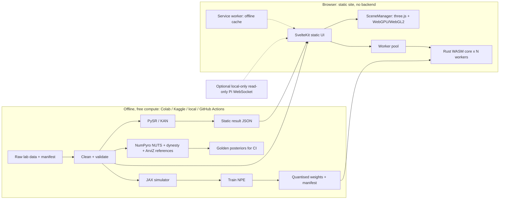

# Band-Gap Observatory: Design and Implementation Document (v2)

**One-line pitch:** A browser-native, zero-backend inference and experiment-design instrument that takes a noisy undergraduate diode-thermometry dataset (PHYC30021) and interrogates it with sloppy-model analysis, microcanonical Hamiltonian Monte Carlo, nested sampling, Stein particle swarms, optimal transport, Koopman operators and amortised neural posteriors, then lets anyone watch the physics, from electrons crossing a gap to the colour of an LED, in a GPU-rendered interface.

**Hard constraints:** static site on GitHub Pages; every tool, service and compute resource must be free; no server, database or paid API at any stage.

**Status:** Design v2. Items marked **[VERIFY]** are recalled from memory and must be checked against primary sources before they go into code or public copy.

---

## 0. Changes from v1

| Change | Reason |
|--------|--------|
| Added a catalogue of esoteric algorithms with explicit roles, visuals and tests (Section 3) | Requested; also the main differentiator |
| In-browser sampler is now **microcanonical Langevin/Hamiltonian Monte Carlo (MCLMC)**; NUTS is offline reference only | Simpler to implement in Rust, less exotic than a tree-building sampler, and a better story; NUTS in NumPyro remains the ground truth |
| Added **nested sampling** (evidence) and **Stein variational gradient descent** (visual inference) | Evidence is the principled basis for model comparison; both make striking visuals |
| Added **sloppy-model / information-geometry** analysis | Explains why E_g is hard to pin down and what the lab's temperature range does about it |
| Added **optimal transport**, **Koopman/DMD with control**, **state-space Gaussian processes**, **Bose-Einstein gap model** | Unusual, physically motivated and visually rich |
| **Dropped ONNX Runtime Web**; neural-posterior inference is a small hand-written Rust engine | ORT Web payload is several MB, hostile to free hosting and mobile; a flow with a few hundred thousand weights needs about 300 lines of Rust |
| Band structure is computed on the CPU in a worker (real-symmetric formulation); WebGPU is reserved for visuals and particle inference | A 100-ish-dimension real-symmetric eigenproblem per k-point is fast on CPU; GPU buys little and costs portability |
| Added complete GitHub Pages deployment, CI, size budgets, PWA offline mode, free training compute | Requested |
| Added a full frontend art-direction and scene specification (Section 6) | Requested |

---

## 1. Positioning and honest framing

The measurement (band gap from the temperature dependence of a forward-biased diode at constant current) is a classic teaching experiment (Collings 1980; Precker and da Silva 2002). The site never claims scientific novelty. The claims it does make:

1. The lab's straight-line analysis hides assumptions (ideality, series resistance, prefactor temperature dependence, sensor lag, gap curvature). The app **tests those assumptions against the data** and reports which are supported.
2. The most interesting result may be *negative*: the data may be **sloppy**, meaning E_g is strongly degenerate with other parameters over the sampled temperature range. The app shows why, and which measurement would fix it.
3. The same dataset is a vehicle for demonstrating modern and unusual inference, signal-processing and visualisation techniques, all validated and running client-side.

**Central question (the narrative spine):** *Given a real, imperfect measurement, how much do we actually know about the band gap, which assumptions does the data support, and what should we measure next?*

### Goals
- G1. Reproduce the lab's E_g values (Ge, Si, red, green, blue) and attach a defensible uncertainty.
- G2. Compare physical model variants by **marginal likelihood (nested sampling)** and by **out-of-sample prediction (PSIS-LOO)**, and report disagreement honestly.
- G3. Provide interactive, calibrated inference in the browser, including instant amortised posteriors.
- G4. Quantify sloppiness and use it to drive experiment design.
- G5. Deliver a portfolio-grade visual experience that stays fast and accessible.
- G6. Stay reproducible: every number on the site traces to code, data and a commit hash.

### Non-goals
- No first-principles electronic-structure claims; no claim of beating published band gaps.
- No server, accounts, tracking cookies or remote hardware actuation.

---

## 2. Free-tier constraints and the decisions they force

| Constraint (verify current limits in GitHub docs) | Consequence for design |
|---|---|
| GitHub Pages on a free plan needs a **public repository** | Treat the repo as a product: clean history, license, no secrets |
| Published site limit about 1 GB; soft bandwidth about 100 GB/month; soft limit about 10 builds/hour | Target **under 60 MB total**, initial route under 400 KB gzip; do not deploy on every commit to a feature branch |
| **No custom response headers**, so no COOP/COEP | **No SharedArrayBuffer/WASM threads.** Parallelism = several Web Workers each with its own WASM instance (embarrassingly parallel chains). Do not use `coi-serviceworker` hacks |
| Fixed short `Cache-Control` (about 10 minutes) | Content-hashed filenames plus a **service worker** for offline-first caching |
| Gzip served; Brotli not reliable | Budget with **gzip** sizes; quantise weights; use `wasm-opt -Oz` |
| **Git LFS files are not served by Pages** | Keep every asset small and plain in git (each file well under 10 MB) |
| No server-side code | All state in the URL hash (shareable permalinks), `localStorage`/IndexedDB |
| Free CI: GitHub Actions is free for public repos (standard runners) | Build, test, Lighthouse and deploy in Actions; keep jobs under a few minutes with caching |
| Free GPU compute only via notebooks (Google Colab free tier, Kaggle notebooks) or local machine | Training is **offline and one-off**; trained weights are committed as small quantised files; a CPU-only fast path in CI regenerates reference posteriors |
| No paid APIs | No LLM inference, no hosted vector DBs, no managed analytics |

If Pages ever becomes a limitation, the same `build/` folder deploys unchanged to Cloudflare Pages or Netlify free tiers (Section 8.9).

---

## 3. Algorithm catalogue: what, why, where it appears

Tiers: **T1** ships in the MVP; **T2** signature features (release 1.0); **T3** stretch.

| # | Technique (origin) | Role in this project | Visual it drives | Tier |
|---|---|---|---|---|
| 3.1 | Sloppy-model analysis and information geometry (Brown and Sethna 2003; Machta et al. 2013) | Fisher-information spectrum; explains degeneracy of E_g, ln B, η; drives experiment design | Fisher ellipsoid "pancake", eigenvalue ladder | T1 |
| 3.2 | Hyper-dual-number automatic differentiation (Fike and Alonso 2011) | Exact gradients and Hessians for Fisher, Laplace, MCLMC | none (infrastructure) | T1 |
| 3.3 | Microcanonical Langevin/Hamiltonian Monte Carlo (Robnik, Seljak et al.) | In-browser sampler | Chains as comet trails | T1 |
| 3.4 | Nested sampling (Skilling 2006) | Model evidence, Bayes factors, Occam factors | "Shrinking light" live-point animation | T1 |
| 3.5 | Stein variational gradient descent (Liu and Wang 2016) | Deterministic particle inference | GPU particle swarm flowing to the posterior | T2 |
| 3.6 | Optimal transport: Sinkhorn and sliced Wasserstein (Cuturi 2013; Bonneel et al. 2015) | Quantitative posterior comparison; model-to-model posterior morphing | Particle displacement interpolation | T2 |
| 3.7 | Amortised neural posterior estimation with neural spline flows; SBC and TARP calibration | Millisecond posteriors with calibration evidence | Live posterior while dragging sliders | T1 |
| 3.8 | State-space Gaussian process (Matérn as SDE) and unscented Kalman filtering | Lag-aware latent temperature; model discrepancy in O(N) | Smoothed temperature ribbons | T2 |
| 3.9 | Koopman operator via Hankel-DMD with control (Schmid 2010; Proctor et al. 2016) | Data-driven thermal time constants from sensor data | Eigenvalues in the complex plane | T2 |
| 3.10 | Bose-Einstein (two-oscillator) gap model versus Varshni (Viña et al. 1984) | Physics-motivated competing gap models, compared by evidence | Gap-vs-T curves with evidence badges | T2 |
| 3.11 | Empirical pseudopotential method in real-symmetric form, Lanczos, density of states, n_i(T) link | Band structure; connects crystal to I_s(T) | 3D band ribbons, DOS, LED | T2 |
| 3.12 | Kernel polynomial method for disordered Si-Ge alloy density of states (Weiße et al. 2006) | Large sparse tight-binding supercell, stochastic trace | Alloy slider; DOS evolution | T3 |
| 3.13 | Lambert W and two-current PTAT identity | Exact I(V) solutions; Boltzmann-constant and thermocouple self-calibration | Approximation-breakdown map | T1 |
| 3.14 | Bayesian experimental design: Fisher D-optimality plus nested-Monte-Carlo EIG | Next-measurement recommender | Glowing EIG terrain | T2 |
| 3.15 | Conformal prediction wrappers (Angelopoulos and Bates) | Distribution-free coverage on predictions | Coverage dial | T2 |
| 3.16 | Symbolic regression with units constraints, KAN comparator (Cranmer 2023; Liu et al. 2024) | Equation discovery constellation | Pareto "constellation" | T3 |
| 3.17 | Analytic CIE colour-matching fit (Wyman, Sloan and Shirley 2013) | Physical spectrum to sRGB; the UI accent *is* the band gap | Global accent colour, CIE diagram | T1 |

### 3.1 Sloppy-model analysis and information geometry
**Idea.** For a Gaussian-noise model, the Fisher information is F = Jᵀ Σ⁻¹ J with J_ij = ∂f(x_i)/∂θ_j. Its eigenvalues of "sloppy" models span many orders of magnitude: a few *stiff* parameter combinations are well constrained and many *sloppy* ones are not (Brown and Sethna 2003; Machta et al. 2013; Transtrum et al. 2015).

**Why here.** In V(T) = (kT/q)[ln(I/B) − η ln T] + E_g(T)/q, the terms E_g, ln B and η are nearly collinear over a 60-100 K window around room temperature. The linear-fit intercept is a combination of them, not E_g alone. Sloppiness is the rigorous version of that statement.

**Use in the app.**
1. Compute J by AD on the model at the data's design points; build F in log-scaled parameters; eigendecompose (small dense symmetric solve).
2. Show the eigenvalue ladder (log scale) and the Cramér-Rao ellipsoid; label eigenvectors in physical terms ("mostly E_g − (kT₀)·ln B direction").
3. **Temperature-range slider:** recompute F for hypothetical ranges (e.g. 280-330 K versus 150-400 K); watch the ellipsoid thicken along the sloppy axis. This directly answers "how much would a wider sweep help?"
4. Feed F into design (3.14) and into the Gaussian initialisation for samplers.

**Validation.** Compare F⁻¹ with posterior covariance in the near-Gaussian regime; check Cramér-Rao bound on simulated replications.

### 3.2 Hyper-dual AD
Forward-mode dual numbers give first derivatives; hyper-dual numbers give exact second derivatives with no finite differences. Dimension is at most about 10, so forward-mode cost is acceptable. Use the `num-dual` crate if its size and wasm build are acceptable; otherwise a 150-line custom type. Used for gradients (samplers), Hessians (Laplace, Fisher cross-check) and sensitivities (∂V/∂T drives lag-to-bias propagation).

### 3.3 Microcanonical Langevin / Hamiltonian Monte Carlo (MCLMC)
**Idea.** Instead of Hamiltonian dynamics with a Gaussian momentum, the *microcanonical* ensemble uses dynamics on a constant-energy surface with unit-norm velocity, so the energy conservation of the integrator is a built-in diagnostic and there is no tree building or accept/reject in the Langevin variant (Robnik, De Luca, Silverstein and Seljak; Robnik and Seljak; **[VERIFY]** titles and equation numbers).

**Why here.** The target is low-dimensional and smooth but strongly correlated (see 3.1). MCLMC adapts step size and decoherence length from simple statistics, is small to implement, and makes a good talking point.

**Implementation plan.**
- Unconstrained parameters (log/logit transforms with Jacobians).
- Velocity lives on the unit sphere; implement the closed-form velocity update from the paper, then the position update; partial velocity refresh with noise to set the decoherence length L.
- Adapt step size ε by targeting a bounded energy-variance per dimension; set L from posterior scale estimated during warmup (published heuristics; **[VERIFY]**).
- Run K chains in K workers; diagnostics: split R-hat, bulk ESS, energy error trace; refuse the "converged" badge if diagnostics fail.
- The **energy-error trace is drawn live** as a small oscilloscope widget.

**Validation.** Match NumPyro NUTS posteriors (quantiles, correlations) on M0-M4 for simulated and real data in CI; recover known parameters in coverage tests; compare ESS per second with a baseline random-walk sampler.

**Fallback.** If MCLMC proves fragile, ship a simple HMC with dual-averaging in Rust and keep MCLMC as an experimental toggle.

### 3.4 Nested sampling for evidence
**Idea.** Nested sampling (Skilling 2006) turns the evidence integral Z = ∫L(θ)π(θ)dθ into a one-dimensional integral over prior volume X by repeatedly replacing the lowest-likelihood "live point" with a new draw constrained to higher likelihood; E[ln X_i] ≈ −i/N and the posterior is a free by-product.

**Use.** Model comparison M0-M6: ln Z, Bayes factors, and the **Occam factor** (information H). Evidence penalises complexity automatically and is sensitive to priors, so it is shown beside PSIS-LOO, which is predictive and less prior-sensitive. When they disagree, the ledger says so and shows prior sensitivity.

**Implementation plan (Rust).**
- N = 300-600 live points; unit-cube prior transform; constrained sampling by **slice sampling** (Neal 2003; as used in PolyChord) with a covariance-aligned basis updated from live points.
- Stopping when the remaining evidence fraction is below about 10⁻³; ln Z uncertainty from sqrt(H/N); run several independent replicates to display ln Z spread.
- Emit an event stream (live points, current likelihood threshold, ln Z estimate) each iteration for the visual.
- Cost estimate: roughly 10⁵-10⁶ likelihood evaluations for 4-7 parameters and about 60 data points. This is seconds in WASM.

**Validation.** Analytic test cases (Gaussian likelihood and prior: closed-form ln Z); agreement with `dynesty` on the real data in the offline pipeline; repeated-run variance matches the theoretical error.

### 3.5 Stein variational gradient descent (SVGD)
**Idea.** Evolve n particles by x_i ← x_i + ε φ(x_i), φ(x) = (1/n) Σ_j [k(x_j, x) ∇ log p(x_j) + ∇_{x_j} k(x_j, x)]. The first term pulls particles toward high density; the second repels them, maintaining diversity (Liu and Wang 2016).

**Use.** A **purely visual and educational** inference mode on two chosen parameters (e.g. E_g versus ln B, others fixed at conditional means or marginalised by Laplace), plus a quantitative comparison with MCLMC. Honest caveat: SVGD with an RBF kernel underestimates variance in higher dimension; the UI says so and shows the discrepancy against MCLMC via sliced Wasserstein (3.6).

**Implementation.** Gradients ∇ log p(x_j) computed in WASM (autodiff); pairwise kernel sum on the GPU. Bandwidth by the median heuristic. WGSL sketch:

```wgsl
struct Params { n: u32, h: f32, eps: f32, _pad: u32 };
@group(0) @binding(0) var<storage, read>       xs:    array<vec2f>;   // particles
@group(0) @binding(1) var<storage, read>       score: array<vec2f>;   // ∇ log p at each particle (from WASM)
@group(0) @binding(2) var<storage, read_write> phi:   array<vec2f>;
@group(0) @binding(3) var<uniform>             u:     Params;

@compute @workgroup_size(64)
fn main(@builtin(global_invocation_id) gid: vec3u) {
  let i = gid.x;
  if (i >= u.n) { return; }
  var acc = vec2f(0.0);
  let h2 = u.h * u.h;
  for (var j = 0u; j < u.n; j = j + 1u) {
    let d = xs[i] - xs[j];
    let k = exp(-dot(d, d) / (2.0 * h2));
    acc += k * score[j] + k * d / h2;       // attraction + repulsion
  }
  phi[i] = acc / f32(u.n);
}
```
Particle counts: 1,024 default; 4,096 when WebGPU is present; 256 on the CPU fallback (pairwise work in Rust/WASM).

### 3.6 Optimal transport
**Use.**
1. **Quantitative comparison** of posteriors from different engines or models using **sliced Wasserstein-2** (random 1D projections, sort, cost O(n log n) per projection). This yields a single "engine agreement" number with a bootstrap noise floor.
2. **Posterior morphing visual:** compute an entropic-regularised **Sinkhorn** coupling between particle sets from two models (e.g. M0 and M4), then animate **displacement interpolation** x(t) = (1−t)x_i + t·x_{π(i)}. The viewer literally sees the posterior move when an assumption is added. n ≈ 500-1,000 particles per set; Sinkhorn in Rust with a log-domain stabilised iteration.
3. Optional: use the transport map as a diagnostic of how much of the shift is along sloppy versus stiff directions (project displacement onto Fisher eigenvectors).

### 3.7 Amortised neural posterior estimation (NPE)
**Pipeline.** Simulator draws θ from the prior and a run design; summary statistics (or a small set-encoder) map a dataset to an embedding; a conditional **neural spline flow** (Durkan et al. 2019) or conditional flow matching (Lipman et al. 2023) models p(θ | data). Train offline (Colab/Kaggle/local), export weights as raw float16/int8 tensors plus a JSON architecture manifest.

**Inference engine (Rust, about 300 lines).** Dense layers, ReLU/SiLU, rational-quadratic spline transforms, sampling by the inverse flow, log-prob evaluation. No ML framework dependency, so the payload is the weights only (target under 700 KB).

**Calibration, shown in the UI.** Simulation-based calibration rank histograms (Talts et al. 2018), TARP coverage test (Lemos et al. 2023), and an **out-of-distribution warning** (Mahalanobis distance of the embedding to the training distribution).

**Hybrid refinement.** Optionally use NPE samples as a proposal and importance-correct (PSIS) to the exact posterior: "amortise, then refine".

**Golden tests.** Export test vectors from PyTorch; require the Rust engine to agree to float tolerance on log-probs and on a deterministic transform path.

### 3.8 State-space GP and Kalman filtering
**Latent temperature.** State x_t = [T_plate, T_diode, T_LM234, T_tc] with first-order coupling to the plate (Section 5). Unscented Kalman filter (UKF) and Rauch-Tung-Striebel smoother yield the latent junction temperature and a marginal likelihood.

**GP discrepancy as a Kalman state.** A Matérn-3/2 Gaussian process has an exact 2-state linear SDE representation (Hartikainen and Särkkä 2010; Särkkä and Solin 2019), so a GP discrepancy term g(T) in V = f(I, T; θ) + g(T) can be handled in O(N) by augmenting the filter state when inputs are ordered along a 1D index. First version: order by plug-in smoothed temperature; document the approximation when T is uncertain.

**Use.** Report how E_g shifts when lag and discrepancy are modelled; display the "hidden true temperature" ribbon.

### 3.9 Koopman operator via Hankel-DMD with control
**Idea.** Linear operators acting on observables can describe nonlinear or forced dynamics; **dynamic mode decomposition** estimates their dominant eigenvalues from data (Schmid 2010; Williams et al. 2015). With a **delay-embedded (Hankel)** matrix and a known input (Peltier power, switch polarity) use **DMD with control** (Proctor, Brunton and Kutz 2016).

**Use.** From logged thermocouple, LM234 and plate-proxy series, estimate eigenvalues λ_k = exp(ω_k Δt). Time constants τ_k = −Δt / ln|λ_k|. Compare with the parametric RC fit (Section 5). Bootstrap resampling gives eigenvalue clouds. The eigenvalues are plotted in the unit disk; hover shows the corresponding mode shape across sensors.

**Implementation.** Rank-truncated SVD on a (delays × samples) matrix, small enough for Rust (Golub-Kahan or one-sided Jacobi SVD, about 150 lines).

**Caveat.** Noisy data bias DMD eigenvalues (damping underestimated); use total-least-squares DMD or optimised DMD if bias is visible, and say so.

### 3.10 Bose-Einstein versus Varshni gap models
Varshni is empirical. The **Bose-Einstein (single effective phonon) form** from Viña, Logothetidis and Cardona (1984) is physically motivated:

```
E_g(T) = E_B − a_B [ 1 + 2 / (exp(Θ_B / T) − 1) ]            [VERIFY form and parameter definitions]
```

Fit both to V-T data (and to literature gap data offline for priors), and compare by nested-sampling evidence and LOO. Expected finding: over a 270-380 K window the two are practically indistinguishable, which is a useful, honest message, shown with the posterior predictive difference. Models M2 (Varshni) and M2b (Bose-Einstein) are alternatives, not nested.

### 3.11 Pseudopotential band structure, DOS, and the link to I_s(T)
**Real-symmetric EPM.** For homopolar diamond-structure crystals (Si, Ge), choosing the origin at the bond centre makes the symmetric structure factor cos(G·τ) with τ = (a/8)(1,1,1), so the local-pseudopotential Hamiltonian is **real symmetric** (Cohen and Bergstresser 1966). About 113-137 plane waves per k-point. Use Householder tridiagonalisation plus implicit QL; compute the lowest 8-12 bands; or Lanczos for a few bands.

**Form factors (recalled, [VERIFY] against the original paper):** Si a = 5.43 Å, V3 = −0.21, V8 = +0.04, V11 = +0.08 Ry; Ge a = 5.66 Å, V3 = −0.23, V8 = +0.01, V11 = +0.06 Ry.

**Density of states.** Sample the irreducible Brillouin-zone wedge (about 300-1,000 k-points), histogram or Gaussian-smooth eigenvalues, or use the linear tetrahedron method for a cleaner DOS.

**Link to the diode.** The reverse saturation current scales as n_i², with n_i² ∝ N_c N_v exp(−E_g/kT) and N_c, N_v ∝ T^{3/2} times effective-mass factors. Effective masses estimated from EPM band curvature near the band edges provide a **qualitative** justification for the T^η prefactor and the prior η ≈ 3 (**[VERIFY]** the full exponent once mobility and diffusion-length dependences are included). This is labelled illustrative.

**Temperature.** Fixed-lattice EPM cannot reproduce real temperature shrinkage. The app (a) applies thermal expansion and a Debye-Waller damping of form factors as an *illustrative, qualitative* shift, and (b) takes the numerical gap from the fitted E_g(T) of Views B and D, displaying both with a plain-language note.

**LED colour.** λ[nm] = 1239.84 / E[eV]; spectrum Gaussian with FWHM about 1.8 kT in energy (ideal thermal broadening); colour via the analytic CIE fit (3.17). **Silicon and germanium gaps are in the infrared**: render as false-colour with an explicit "infrared, invisible" badge rather than a visible colour.

### 3.12 Kernel polynomial method for alloys (T3)
Disordered Si₁₋ₓGeₓ needs large supercells where exact diagonalisation is unattractive. A sparse tight-binding Hamiltonian (sp³s*, parameters from Vogl, Hjalmarson and Dow 1983, **[VERIFY]**) on a 1,000-2,000-atom supercell with random Si/Ge site assignment gives DOS via **Chebyshev moment expansion with stochastic trace** (Weiße et al. 2006): M ≈ 300-600 moments, R ≈ 8-16 random vectors, Jackson kernel damping, sparse mat-vec on the GPU or in WASM. The alloy slider changes x and re-computes DOS in seconds; the band-edge shift versus x shows bowing. This is a stretch because band-edge extraction from KPM is noisy; use Lanczos for edges as a cross-check.

### 3.13 Lambert W and the PTAT identity
- **Lambert W:** for the constant-voltage extension, I(V) with series resistance has a closed form via W; implement in log-domain for large arguments (Halley iteration, asymptotic initial guess; Corless et al. 1996). Powers the "approximation breakdown map" showing where the lab's I ≈ I_s exp(qV/kT) simplification fails (lab Q2, Q9).
- **Two-current identity:** ΔV = (n k T/q) ln(I₁/I₂) + (I₁ − I₂)R_s, independent of E_g and B. Gives n·k/q (a "measure the Boltzmann constant with a diode" demo) and a thermocouple-independent temperature reference. Fit with total least squares or errors-in-variables Bayesian regression.

### 3.14 Experiment design
- **Fast path: D-optimal design.** Choose the next (T, I) maximising log det(F_current + F_candidate) with F from 3.1. Milliseconds, closed-form-ish.
- **Full path: expected information gain.** Nested Monte Carlo with common random numbers over a small candidate grid, plus a cross-check via an NPE-based variational bound. Report EIG (bits) with Monte Carlo error.
- Compare against an evenly spaced sweep on simulated runs and report win rate, including failure cases (e.g. when lag dominates).

### 3.15 Conformal prediction
Split-conformal or conformalised quantile intervals on predicted V and on NPE credible regions (marginal coverage guarantees). A "coverage dial" shows nominal versus empirical coverage on held-out simulated runs.

### 3.16 Symbolic regression and KAN comparator (T3, offline)
PySR with a restricted operator set and units-aware constraints, run on (a) noiseless simulated data (sanity), (b) noisy simulated, (c) real data; optional Kolmogorov-Arnold-network fit as a contrasting black-box-to-formula route. Precompute with fixed seeds; display as a **constellation**. Label as exploratory: recovery of the Shockley/Varshni structure is not evidence for it.

### 3.17 Physical colour
Spectrum to XYZ via the analytic multi-lobe Gaussian fit to CIE 1931 colour-matching functions (Wyman, Sloan and Shirley 2013), then to sRGB with gamut mapping in OKLCH. The UI's global `--accent` token is set at runtime from the currently selected diode's emission colour, so the interface visibly changes with the physics.

---

## 4. Scientific model specification (single source of truth)

### 4.1 Forward model (constant-current direction)
```
V = I R_s + n V_T ln( I / I_s(T) + 1 ),                V_T = kT/q
I_s(T) = B T^η exp( − E_g(T) / (n_a k T) )
```
Ideal limit (n = n_a = 1, R_s = 0, I ≫ I_s): V(T) = (kT/q)[ln(I/B) − η ln T] + E_g(T)/q; with η = 0 and E_g constant this is the lab's linear relation (lab Eq. 8).

Gap models: Varshni E_g(T) = E_g(0) − αT²/(T + β); Bose-Einstein (3.10).

### 4.2 Parameter provenance audit **[VERIFY, Phase 0]**
The lab handout lists Si E_g(0) = 1.12 eV with α = 7.02×10⁻⁴ eV/K and β = 1108 K, and Ge E_g(0) = 0.67 eV. From memory, 1.12/0.67 eV are close to **room-temperature** gaps, while the 0 K gaps are roughly 1.16-1.17 eV (Si) and 0.74 eV (Ge), and the (7.02×10⁻⁴, 1108) pair is usually quoted with E_g(0) ≈ 1.16 eV. Back-of-envelope (unchecked): taking literature Varshni parameters (Si: 1.1557 eV, 7.021×10⁻⁴, 1108; Ge: 0.7437 eV, 4.774×10⁻⁴, 235) and extrapolating the tangent at about 330 K to T = 0 gives roughly 1.2 eV (Si) and 0.78 eV (Ge). If confirmed, the lab's comparison targets are not like for like, and the app's "What does the straight line actually estimate?" panel shows the intercept, the 0 K gap and the room-temperature gap together. Also recompute the report's wavelengths (1239.84/2.030 ≈ 610.7 nm versus 613 nm listed) and resolve the two R_set values listed in the report.

### 4.3 Model variants

| ID | Description |
|----|-------------|
| M0 | Lab model: linear V-T, ideal diode (E_g, ln B) |
| M1 | + prefactor T^η |
| M2 | + Varshni E_g(T) |
| M2b | Bose-Einstein E_g(T) instead of Varshni |
| M3 | + ideality n |
| M4 | + series resistance R_s |
| M5 | + sensor lag (latent diode temperature, Section 5) |
| M6 | + state-space GP discrepancy |

### 4.4 Instrument model
- **ADC (ADS1115):** signed 16-bit, LSB = FSR/32768 (125 µV at ±4.096 V FSR); σ_q = LSB/√12 plus fitted noise floor.
- **Current:** I = V_Rtemp / R_temp with propagated uncertainty; use datasheet resistor tolerances.
- **LM234 thermometer:** T = I_set R_set / γ, γ ≈ 227 µV/K at 293 K (fitted per device).
- **Thermocouple and multimeter:** offset/gain priors from the meter's datasheet **[fill in]**, plus first-order lag.
- **Constant-current non-ideality:** slow multiplicative drift of I_set, measured per step where possible.

### 4.5 Priors (sensitivity-analysed)
E_g(0): wide Normal (weak) or literature-centred (informative); ln B: weak Normal scaled by simulation; η: Normal(3, 0.5) **[VERIFY]**; n: LogNormal around 1 with n ≥ 1 by construction; R_s: HalfNormal at rectifier scale; instrument terms truncated from datasheets. Every ledger entry carries a prior-sensitivity flag.

---

## 5. Thermal twin (latent-temperature model)

```
dT_plate/dt = ( P_peltier(t) − G_sink (T_plate − T_amb) ) / C_plate
dT_j/dt     = ( T_plate − T_j ) / τ_j        for j in {diode, LM234, thermocouple}
```
Discretise exactly with the matrix exponential at the logging interval. Observation: thermocouple reading (offset, noise), LM234-derived temperature (γ, noise), and the nonlinear diode voltage V = f(I, T_diode; θ).

**Inference.** UKF + RTS for the marginal likelihood given (τ, G_sink, C_plate, noises, θ); sample all with MCLMC using the filter's marginal likelihood. **Validate** the Kalman approximation against full latent-variable HMC offline (JAX) on synthetic data to confirm it does not bias E_g.

**Cross-check.** Koopman/DMDc eigenvalues (3.9) versus the RC model's τ's; disagreement is reported, not hidden.

**Control demo (simulation only).** Linear-quadratic MPC on the identified plate model versus PID with the lab's actuator limits (12 V, 4 A). The public site never commands hardware.

---

## 6. Frontend art direction and scene specification

### 6.1 Concept: "Spectral Instrument"
The interface should feel like a precision lab instrument that happens to be beautiful: a dark "darkroom" canvas, hairline panels, and **light as the only saturated colour**, with that colour *derived from the physics* (the selected diode's emission colour). Visuals are physically motivated, not decorative; every animated scene corresponds to a real computation shown on screen.

### 6.2 Design tokens
```css
:root {
  --bg:        oklch(0.14 0.012 265);
  --surface:   oklch(0.18 0.014 265);
  --surface-2: oklch(0.22 0.016 265);
  --ink:       oklch(0.96 0.01 90);
  --ink-dim:   oklch(0.74 0.012 265);
  --hair:      oklch(1 0 0 / 0.10);
  --accent:    var(--gap-colour, oklch(0.80 0.16 70));   /* set at runtime from E_g (3.17) */
  --ir:        oklch(0.55 0.20 25);                      /* false-colour for infrared gaps */
  --radius:    14px;
  --ease-out:  cubic-bezier(.2,.8,.2,1);
}
:root[data-theme="daylight"] { /* paper-white variant with inverted ink, same accent logic */ }
@media (prefers-reduced-motion: reduce) { * { animation-duration: .001ms !important; transition-duration: .001ms !important; } }
```
Contrast: verify the accent against `--bg` in CI (computed WCAG ratio); fall back to a lightness-adjusted accent if it fails.

### 6.3 Typography (all free/OFL; self-hosted via Fontsource, Latin subset, `woff2`, `font-display: swap`, preload only the display face)
- Display: **Instrument Serif** (editorial headlines, large numerals)
- UI/body: **Geist Sans** or Hanken Grotesk
- Data and equations: **JetBrains Mono** or Geist Mono; **KaTeX** for equations (self-hosted CSS/fonts, lazy-loaded)

Use tabular numerals for all measured values; large "instrument readouts" for E_g with an uncertainty halo.

### 6.4 Layout and motion principles
- 12-column grid; panels as "instrument cards" with hairline borders and subtle inner glow tinted by `--accent`.
- Scroll-driven story on the landing page (CSS scroll-driven animation with a GSAP ScrollTrigger or Motion fallback; check current licence terms).
- Physical easing; no gratuitous parallax. Every motion has a **static, equal-information alternative** under `prefers-reduced-motion`.
- A persistent bottom "status bar" shows live compute state (sampler, ESS, evidence, backend: WebGPU or WebGL2) in monospace: engineering transparency doubles as a visual signature.
- Command palette (⌘/Ctrl-K) to jump between scenes and toggle models; **Tour mode** (auto-advancing, captioned, about 90 seconds) for interviews; **Share card** exports the current view to PNG with permalink QR (generated client-side).

### 6.5 Rendering architecture
- **three.js with WebGPURenderer and TSL** (WebGPU when available, automatic WebGL2 backend otherwise) for 3D and particle scenes. Compute passes (SVGD kernel sums, hero particles, heat-field solver) run only on WebGPU; each has a **stateless or low-count fallback** (Section 6.7).
- **2D charts:** D3 scales and axes with Canvas 2D for dense layers (posterior clouds, 10⁵ points) and SVG for annotations and text (accessible). Observable Plot for quick plots in non-hero views.
- A single `SceneManager` owns the GPU device and a shared rAF loop; scenes mount/unmount through IntersectionObserver and the Page Visibility API; a **frame-time governor** adapts particle counts and render scale (target 60 fps on mid-range laptops, 30 fps floor on phones).
- Debug HUD behind the `~` key: backend, adapter info, particle count, frame ms, worker utilisation.

### 6.6 Scene catalogue

| ID | Scene | What the visitor sees and does | Tech | Data | Accessible equivalent |
|----|-------|-------------------------------|------|------|-----------------------|
| S0 | **The Gap** (hero) | A glowing "electron sea": two particle bands separated by a gap whose height is E_g(T). Cursor height or a temperature slider heats the crystal; thermally excited electrons jump the gap (Fermi-Dirac occupancy, exaggerated and labelled "not to scale"), recombine and emit photon streaks in the exact emission colour; the whole UI accent shifts to that colour. Headline: *"How wide is the gap, and how sure are we?"* | WebGPU compute, 200k particles; WebGL2 stateless vertex-shader particles at 20-30k | Varshni/BE curve | Static diagram with readout "E_g = … eV at … K, emission … nm" |
| S1 | **The Noisy Line** | Real V-T scatter; scroll reveals the lab's straight line, then a bundle of 500 posterior lines rendered as thin light rays, then the posterior predictive band | Canvas 2D | Recorded runs, MCLMC samples | Table plus summary sentence |
| S2 | **Shrinking Light** (nested sampling) | 400 live points in (E_g, ln B) plane contracting through glowing nested likelihood contours; ln Z accumulates in a side meter; scrub the timeline; toggle models and watch ln Z diverge | Canvas/WebGL, event stream from Rust | Nested-sampling events | Final ln Z table and prose |
| S3 | **The Swarm** (SVGD) | 1-4k particles flow into the posterior with visible repulsion; sliders for bandwidth and step; overlay MCLMC samples and show sliced-W2 agreement | WebGPU compute | SVGD state | Static end-state plot plus W2 number |
| S4 | **Sloppiness** | A 3D Fisher ellipsoid, thin as a needle or pancake, rotatable; eigenvalue ladder; **temperature-range slider** thickens the ellipsoid as the sweep widens | three.js | Fisher from AD | Eigenvalue table and plain sentence ("one combination is constrained 300× better than another") |
| S5 | **Morph** | Posterior particles of M0 flow to M4 along the optimal-transport map; trails coloured by stiff/sloppy displacement; W2 distance readout | WebGL/WebGPU instanced points | Sinkhorn coupling | Before/after plots |
| S6 | **Thermal Twin** | Shader-driven heat field of the plate; sensor probes with lag trails; smoothed latent temperature ribbon; Koopman eigenvalues in the unit disk alongside the RC time constants; PID versus MPC race | Fragment-shader 2D heat solver or compute; D3 for the disk | UKF/RTS, DMDc | Time-series chart and τ table |
| S7 | **Crystal to Colour** | 3D band-structure ribbons along Γ-X-W-L-Γ-K, DOS at the side, the indirect gap marked; a lamp rendered with bloom in the emission colour; CIE 1931 chromaticity diagram with the point moving as temperature changes; IR diodes shown in false colour with a badge | three.js, EPM in a worker | EPM, fitted E_g(T) | Band-edge table and wavelength/colour description |
| S8 | **Next Measurement** | A luminous terrain of expected information gain over (T, I); the recommended point pulses; "you versus the designer" game on a simulated diode with posterior-width race chart | three.js heightfield | D-optimal and EIG | Ranked candidate table |
| S9 | **Constellation** (T3) | Candidate equations as stars positioned by complexity and loss; click for a KaTeX-rendered equation and its fit | Canvas | PySR output | Sorted equation list |
| S10 | **Evidence Ledger** | An editorial-style typographic table: ln Z, Bayes factors, ΔELPD ± SE, stacking weights, prior-sensitivity flags, and a one-paragraph verdict ("The data prefer including X; they cannot distinguish Y from Z") | HTML/CSS | NS + LOO | The table *is* the accessible form |

### 6.7 Degradation matrix

| Capability | Preferred | Fallback 1 | Fallback 2 |
|---|---|---|---|
| Hero (S0) | WebGPU compute particles | WebGL2 stateless vertex-shader particles | Pre-rendered poster plus static diagram |
| SVGD (S3) | WebGPU kernel sums | WASM pairwise (n ≤ 256) | Precomputed trajectory replay |
| 3D scenes | WebGPURenderer | WebGL2 | 2D SVG diagrams |
| Band structure | CPU worker (EPM) | Fewer k-points | Precomputed bands |
| Inference | Rust MCLMC in workers | Fewer chains/samples | Precomputed posteriors |

Feature detection at load; the status bar states the active path. The core story and all numbers are available on every path.

### 6.8 Accessibility
WCAG 2.2 AA target; keyboard-operable controls and visible focus; ARIA live regions for progress and results; every plot has an adjacent table and a generated text summary; colour-blind-safe palettes with redundant encodings; reduced-motion mode; touch targets at least 44 px; responsive from 360 px; heavy scenes are opt-in on small devices (a "Play interactive scene" button instead of autoplay). CI runs axe-core and Lighthouse.

---

## 7. Software architecture

### 7.1 System overview


### 7.2 Repository layout
```
bandgap-observatory/
├─ crates/                         # Rust workspace
│  ├─ bgo-physics/                 # diode, Varshni, Bose-Einstein, Lambert W, colour (CIE fit), units
│  ├─ bgo-ad/                      # dual + hyper-dual numbers (or thin wrapper over num-dual)
│  ├─ bgo-infer/                   # mclmc, nested sampling, svgd (CPU), laplace, diagnostics (R-hat, ESS)
│  ├─ bgo-info/                    # Fisher, Cramér-Rao, D-optimal, EIG, sloppy spectrum
│  ├─ bgo-ot/                      # Sinkhorn (log-domain), sliced Wasserstein, displacement interpolation
│  ├─ bgo-ssm/                     # UKF, RTS, Matérn-3/2 SDE state, Hankel-DMDc, SVD
│  ├─ bgo-nn/                      # flow inference engine (MLP + RQ-spline), weight loader
│  ├─ bgo-epm/                     # EPM Hamiltonian, tridiagonal QL/Lanczos, DOS, (T3) KPM
│  └─ bgo-wasm/                    # wasm-bindgen API surface, typed-array I/O
├─ web/                            # SvelteKit app (adapter-static)
│  ├─ src/lib/engine/              # worker pool, protocol, WASM loader
│  ├─ src/lib/scenes/              # S0..S10 as self-contained modules
│  ├─ src/lib/ui/                  # tokens, components, status bar, command palette
│  ├─ src/lib/state/               # Svelte stores, URL-hash permalinks
│  ├─ src/routes/                  # /, /infer, /twin, /explore, /design, /ledger, /about
│  ├─ src/service-worker.ts
│  └─ static/{wasm,weights,data}/
├─ train/                          # Python: simulator.py, train_npe.py, reference.py, sr.py, export.py
├─ data/                           # raw/, clean/, manifest.json, schema.json
├─ docs/                           # model.md (this spec), validation.md, a11y.md, architecture.md
├─ .github/workflows/              # ci.yml, deploy.yml, refs.yml (nightly reference refresh)
└─ README.md
```

### 7.3 Rust API sketches
```rust
// bgo-infer
pub trait LogDensity {
    fn dim(&self) -> usize;
    fn logp_grad(&self, x: &[f64], grad: &mut [f64]) -> f64;      // via bgo-ad
}
pub struct MclmcConfig { pub eps0: f64, pub l0: f64, pub n_warmup: usize, pub n_samples: usize, pub refresh: f64 }
pub fn mclmc<T: LogDensity>(t: &T, x0: &[f64], cfg: &MclmcConfig, rng: &mut impl Rng,
                            on_event: impl FnMut(ChainEvent)) -> Chain;

pub trait LogLikePrior {                                          // unit-cube nested sampling interface
    fn dim(&self) -> usize;
    fn prior_transform(&self, u: &[f64], theta: &mut [f64]);
    fn loglike(&self, theta: &[f64]) -> f64;
}
pub fn nested_sampling<T: LogLikePrior>(t: &T, n_live: usize, dlogz: f64, rng: &mut impl Rng,
                                        on_event: impl FnMut(NsEvent)) -> NsResult; // ln Z, err, H, posterior samples
```
```rust
// bgo-info
pub fn fisher(model: &impl Model, theta: &[f64], design: &[Design], noise: &[f64]) -> Matrix;
pub fn sloppy_spectrum(f: &Matrix) -> (Vec<f64> /*eigenvalues*/, Matrix /*eigenvectors*/);
pub fn d_optimal_next(model: &impl Model, theta: &[f64], f0: &Matrix, candidates: &[Design]) -> usize;
pub fn eig_nmc(model: &impl Model, posterior: &[Vec<f64>], d: &Design, n_outer: usize, n_inner: usize, seed: u64) -> (f64, f64);
```
Typed arrays cross the boundary as `Float64Array`/`Float32Array` views; configuration crosses as small structs via `serde-wasm-bindgen`.

### 7.4 Worker architecture and protocol
- The main thread compiles the WASM module once (`WebAssembly.compileStreaming`) and **transfers the compiled `WebAssembly.Module`** to each worker, saving repeated compile time.
- Pool size: `min(hardwareConcurrency − 1, 4)` (2 on mobile). Chains map to workers; nested-sampling replicates map to workers; long single jobs (EPM sweeps, SVGD gradient batches) are chunked.
- Cancellation = terminate and respawn the worker (WASM loops are not interruptible). Progress is streamed as `postMessage` events; large arrays go as transferables.
- Deterministic seeds are stored in the URL state so any view can be re-run.

```ts
type Req =
  | { id: number; kind: 'init'; module: WebAssembly.Module }
  | { id: number; kind: 'mclmc';   model: ModelId; data: Dataset; cfg: MclmcCfg; seed: number }
  | { id: number; kind: 'nested';  model: ModelId; data: Dataset; nLive: number; seed: number }
  | { id: number; kind: 'fisher';  model: ModelId; theta: Float64Array; design: Float64Array }
  | { id: number; kind: 'npe';     data: Dataset; nSamples: number; seed: number }
  | { id: number; kind: 'epm';     material: 'Si' | 'Ge'; kpath: Float64Array };

type Msg =
  | { id: number; kind: 'progress'; frac: number; payload?: Float64Array }   // e.g. live points, energy error
  | { id: number; kind: 'done';     result: unknown }
  | { id: number; kind: 'error';    message: string };
```

### 7.5 State, permalinks, persistence
Svelte 5 stores (runes) for model selection, dataset, settings and results. The **full view state (model, dataset ID, slider values, seeds) is serialised to the URL hash** (CBOR then deflate via `fflate`, then base64url) so every view is a shareable permalink without a server. Heavy results are cached in IndexedDB keyed by content hash.

### 7.6 Data and provenance
Each run: diode ID, material, date, instrument config (ADC gain/FSR, R_set, R_temp, R1, supply), arrays (t, raw ADC counts, derived V, I, thermocouple, LM234 current), notes, known issues. JSON Schema validated in CI; SI units internally; a `manifest.json` records SHA-256 hashes surfaced in the site footer ("Receipts": commit hash, data hash, test status, bundle size, SBC result).

### 7.7 Safety and hardware mode
Optional **local-network, read-only** Raspberry Pi stream to a locally served copy of the site. The public site never connects to hardware and never sends Peltier or power commands. Safety limits (12 V, 4 A; unpowered when idle) remain operator responsibilities.

---

## 8. Deployment on GitHub Pages with only free resources

### 8.1 One-time setup
1. Create a **public** repo `bandgap-observatory`. Settings → Pages → **Source: GitHub Actions**.
2. Site URL will be `https://<user>.github.io/bandgap-observatory/`, so the app needs a **base path**. (A free custom domain via a DNS `CNAME` removes it; Pages provides HTTPS.)
3. Add an empty `static/.nojekyll` so Pages does not process underscore-prefixed folders.

### 8.2 SvelteKit static configuration
```js
// web/svelte.config.js
import adapter from '@sveltejs/adapter-static';
export default {
  kit: {
    adapter: adapter({ pages: 'build', assets: 'build', fallback: '404.html', precompress: false, strict: true }),
    paths: { base: process.env.BASE_PATH ?? '' },
    prerender: { handleHttpError: 'warn' }
  }
};
```
```ts
// web/src/routes/+layout.ts
export const prerender = true;
export const trailingSlash = 'always';   // /infer/ -> infer/index.html on a static host
export const ssr = true;                 // prerendered shell; interactive parts are client-only
```
Interactive scenes are lazy-imported on the client (`onMount` plus dynamic `import()`), so the prerendered HTML is meaningful without JavaScript (title, story text, static figures).

```ts
// web/vite.config.ts (excerpt)
export default defineConfig({
  build: { target: 'es2022' },
  worker: { format: 'es' },
  optimizeDeps: { exclude: ['bgo-wasm'] }
});
```
Load WASM from `static/wasm/` using `base`-aware URLs (`${base}/wasm/bgo_core.[hash].wasm`); workers are created with `new Worker(new URL('./engine.worker.ts', import.meta.url), { type: 'module' })`. Pages serves `.wasm` with the correct MIME type, so `instantiateStreaming` works.

### 8.3 Rust to WASM build
```bash
# release profile (Cargo.toml): opt-level = "z", lto = true, codegen-units = 1, panic = "abort"
RUSTFLAGS="-C target-feature=+simd128" wasm-pack build crates/bgo-wasm --release --target web --out-dir ../../web/static/wasm
# wasm-pack runs wasm-opt; confirm -Oz. Also build a baseline (no-SIMD) variant and pick at runtime with wasm-feature-detect.
```
Keep dependencies lean (`rand_pcg`, `getrandom` with the `js` feature, `serde-wasm-bindgen`; avoid pulling a full linear-algebra crate if it bloats the binary, since dense symmetric solves, SVD and Cholesky are short to implement). **Size budget: core WASM under 700 KB gzip.**

### 8.4 CI/CD workflow
```yaml
# .github/workflows/deploy.yml
name: ci-deploy
on:
  push: { branches: [main] }
  pull_request:
  workflow_dispatch:
permissions:
  contents: read
concurrency:
  group: pages-${{ github.ref }}
  cancel-in-progress: true
env:
  BASE_PATH: /bandgap-observatory
jobs:
  build:
    runs-on: ubuntu-latest
    steps:
      - uses: actions/checkout@v4
      - uses: dtolnay/rust-toolchain@stable
        with: { targets: wasm32-unknown-unknown }
      - uses: Swatinem/rust-cache@v2
      - uses: jetli/wasm-pack-action@v0.4.0
      - uses: actions/setup-node@v4
        with: { node-version: 22, cache: npm, cache-dependency-path: web/package-lock.json }
      - run: cargo test --workspace
      - run: RUSTFLAGS="-C target-feature=+simd128" wasm-pack build crates/bgo-wasm --release --target web --out-dir ../../web/static/wasm
      - run: npm ci && npm run check && npm run test
        working-directory: web
      - run: npm run build
        working-directory: web
      - run: npx playwright install --with-deps chromium
        working-directory: web
      - run: npm run e2e          # runs against `vite preview --base $BASE_PATH`; includes axe-core checks
        working-directory: web
      - run: npx @lhci/cli autorun   # Lighthouse CI budgets (performance, accessibility, best practices, SEO)
        working-directory: web
      - run: node scripts/size-budget.mjs   # fails the build if budgets in 8.6 are exceeded
      - uses: actions/configure-pages@v5
      - uses: actions/upload-pages-artifact@v3
        with: { path: web/build }
  deploy:
    if: github.ref == 'refs/heads/main'
    needs: build
    runs-on: ubuntu-latest
    permissions: { pages: write, id-token: write }
    environment:
      name: github-pages
      url: ${{ steps.deployment.outputs.page_url }}
    steps:
      - id: deployment
        uses: actions/deploy-pages@v4
```
A separate **nightly/manual `refs.yml`** workflow (CPU-only) regenerates NumPyro and dynesty reference posteriors on a small dataset and compares them with the Rust implementations (tolerances in `docs/validation.md`); failures open an issue. Heavy training is **not** run in Actions.

### 8.5 Offline-first caching (service worker)
Use SvelteKit's `src/service-worker.ts` with the `$service-worker` module: precache the app shell and hashed build files; **lazy runtime-cache** WASM, weights and datasets on first use (stale-while-revalidate for data JSON, cache-first for hashed files). Because Pages' short cache lifetime is not controllable, hashed filenames plus the service worker provide instant repeat loads and offline use. Version the cache by commit hash; show an "Update available" toast.

### 8.6 Size and performance budgets (enforced in CI)

| Asset | Budget (gzip) |
|---|---|
| Initial route HTML + JS + CSS | ≤ 150 KB JS, ≤ 30 KB CSS |
| Hero scene (S0) code + shaders | ≤ 60 KB |
| Core WASM (lazy, after first paint) | ≤ 700 KB |
| NPE weights (lazy, on first use of instant inference) | ≤ 700 KB |
| three.js tree-shaken bundle (lazy) | ≤ 250 KB |
| Fonts (subset woff2, total) | ≤ 150 KB |
| Datasets (all runs) | ≤ 2 MB |
| **Total published site** | **≤ 60 MB (hard ceiling 200 MB)** |

Runtime targets on a mid-range phone: largest contentful paint under 2.5 s on a fast connection; instant-inference interactions under 100 ms; MCLMC on M0-M2 under 10 s; hero at 30+ fps with adaptive scaling.

### 8.7 Free offline compute (training and references)
- **NPE training:** simulator in JAX; train in **Google Colab free** or **Kaggle notebooks** (free GPU quotas change, so check current limits) or locally on CPU for small models. Budget about 10⁵-10⁶ simulations, a small spline flow (a few hundred thousand parameters). Export int8/float16 weights, a JSON manifest and golden test vectors; commit them (each file well under 10 MB, no LFS).
- **References:** NumPyro NUTS, `dynesty`, ArviZ (PSIS-LOO), PySR (Julia) run locally, in Colab, or in Actions for small jobs.
- **Reproducibility:** pinned `uv.lock` (Python), `Cargo.lock`, `package-lock.json`, seeds recorded, data hashes verified in CI. Colab notebooks live in `train/notebooks/` with a "Run all" path that regenerates the committed artifacts.

### 8.8 Social preview, analytics, monitoring
- Generate the Open Graph image in CI with Playwright by screenshotting the hero at a fixed state; commit as a build artifact into `static/og.png`.
- Analytics: none by default; if wanted, a free, cookieless option (e.g. GoatCounter or Cloudflare Web Analytics). Disclose in an About page.
- Monitoring: Lighthouse CI history in Actions artifacts; a scheduled workflow that fetches the live URL and checks status, title and WASM MIME type.

### 8.9 Exit paths
The `web/build` output is plain static files. To move to Cloudflare Pages or Netlify free tiers, set `BASE_PATH` empty and add a `_headers` file; that would also unlock cross-origin isolation and WASM threads if ever needed. Nothing in the architecture depends on GitHub-specific features beyond Actions and Pages.

---

## 9. Implementation guide by phase

Eight weeks of focused work. **MVP (v0.1) is the end of Phase 3**, already visually strong and technically distinctive. Later phases are independent.

| Phase | Weeks | Build | Acceptance criteria |
|---|---|---|---|
| **0. Walking skeleton** | 1 | Repo, CI/CD, Pages deploy of a "hello" page that loads a WASM function in a worker and renders a WebGPU triangle with WebGL2 fallback; design tokens, fonts, status bar; data audit (4.2); reproduce the report's linear-fit intercepts | Site live on Pages; Lighthouse and axe green; M0 intercepts match the report's Table 1 within tolerance; written note on the E_g(0) versus room-temperature question with citations |
| **1. Physics, AD, sampler, hero** | 2 | `bgo-physics`, `bgo-ad`, MCLMC, diagnostics; Infer view (corner plot, posterior predictive); **S0 hero**; S1 noisy line | Gradient tests vs finite differences; MCLMC matches NumPyro on M0-M4 (simulated and real); hero hits fps targets on WebGPU and fallback |
| **2. Evidence, sloppiness, swarm** | 3 | Nested sampling; Fisher/sloppy spectrum; **S2 Shrinking Light, S3 Swarm, S4 Sloppiness**; evidence ledger (S10) | ln Z matches closed-form and `dynesty` within error; sloppy spectrum matches posterior covariance in Gaussian regime; ledger gives a defensible verdict on real data |
| **3. Amortised inference and story (MVP)** | 4 | Colab training, quantised weights, Rust flow engine, SBC/TARP and OOD banner; landing story; permalink state; PWA; accessibility pass | Rust engine matches PyTorch golden vectors; SBC and TARP pass; instant mode under 100 ms; all budgets in 8.6 met; **v0.1 release** |
| **4. Thermal twin** | 5 | UKF/RTS, M5; state-space GP (M6); Hankel-DMDc; **S6**; PID versus MPC (simulated) | Synthetic recovery of τ's and E_g shift; Kalman marginal likelihood validated against full latent HMC offline; DMD vs RC time constants reported with intervals |
| **5. Design and transport** | 6 | D-optimal and EIG recommender; **S8 Next Measurement** and game; Sinkhorn/sliced-W2; **S5 Morph**; conformal wrappers | Designer beats an evenly spaced sweep on simulated benchmarks in a stated fraction of cases (failures reported); Sinkhorn validated against exact 1D transport |
| **6. Crystal to colour** | 7 | EPM (real-symmetric), DOS, band ribbons, LED lamp, CIE diagram; Bose-Einstein M2b and its evidence; n_i illustrative link | Si and Ge band-edge ordering and indirect gaps match literature EPM within stated tolerance; IR badge works; evidence comparison Varshni vs BE reported |
| **7. Polish and stretch** | 8 | Tour mode, share card, OG image, command palette, write-up, 90-second demo video; stretch: KPM alloy (3.12), Constellation (S9) | Cross-browser matrix and fallbacks verified; README, validation report and architecture doc complete; "Receipts" footer live |

---

## 10. Verification strategy

| Area | Tests |
|---|---|
| Physics | Ideal limit reduces to lab Eq. 8; Lambert W satisfies the implicit equation to machine precision (property tests); two-current identity on noiseless data |
| AD | Dual and hyper-dual derivatives versus finite differences on random inputs |
| Samplers | Coverage over 200+ simulated replications; MCLMC vs NumPyro quantiles; energy-error and ESS reporting; analytic ln Z for nested sampling; replicate variance matches theory |
| SVGD/OT | SVGD converges on Gaussian targets (with known variance underestimation documented); Sinkhorn vs exact 1D OT; sliced-W2 noise floor via bootstrap |
| NPE | Golden vectors versus PyTorch; SBC rank histograms and TARP; OOD detector on perturbed simulators; conformal coverage |
| State-space | UKF vs analytic Kalman on a linear case; RTS smoothing improves RMSE; DMDc recovers known eigenvalues from simulated plant |
| EPM | Known band-edge energies and symmetry degeneracies (e.g. Γ25′ valence maximum); real-symmetric Hamiltonian check (Hermiticity residual) |
| Regression | M0 on recorded data reproduces report Table 1; golden posteriors from the nightly refs workflow |
| UI | Playwright end-to-end (including base-path routing), axe-core, Lighthouse budgets, visual regression screenshots for key scenes |
| Reproducibility | One-command rebuild of figures and weights; lockfiles; data hashes checked in CI |

---

## 11. Risks and mitigations

| Risk | Impact | Mitigation |
|---|---|---|
| Real data is too narrow in T to identify E_g separately | Underwhelming headline | Make sloppiness the story; S4 shows why; S8 shows what to measure; optionally collect a wider-range dataset |
| MCLMC is fragile or poorly tuned | Wrong posteriors | NumPyro reference in CI; HMC fallback; diagnostics gate the "converged" badge |
| NPE miscalibrated off-distribution | Misleading instant answers | SBC, TARP, OOD warning, one-click exact sampler |
| SVGD variance underestimation misread as truth | Misleading visual | In-UI caveat and W2 comparison with MCLMC |
| Lab parameter issue (4.2) is my misreading | Embarrassing claim | Verified against primary sources in Phase 0 before any public statement |
| WebGPU variability across devices | Broken visuals | Detection, degradation matrix (6.7), stateless fallbacks |
| Mobile performance | Poor first impression | Opt-in heavy scenes, frame-time governor, strict budgets in CI |
| Scope creep from the esoteric catalogue | Never ships | Tiers; MVP at Phase 3; stretch items (3.12, 3.16) droppable |
| Free-tier limits change | Deployment breaks | Exit path (8.9); site well under limits; no dependence on paid features |
| Data/IP permissions | Cannot publish | Resolve consent and attribution in Phase 0; simulator mode works without real data |
| EPM temperature story misread as quantitative | Physics inaccuracy | Explicit "illustrative" labelling; gap value from fitted E_g(T) |
| Licence issues (fonts, GSAP, libraries) | Takedown | Track licences in `docs/licences.md`; prefer OFL/MIT/Apache assets |

---

## 12. Portfolio packaging
- **README:** central question, hero GIF, "what is novel and what is not" (Section 1), validation summary, architecture diagram, and free-tier deployment notes.
- **About / How it's built page:** interactive architecture diagram; CI-generated stats (bundle sizes, test counts, SBC result, Lighthouse scores).
- **Write-up:** a short methods article covering model, inference, validation and limitations.
- **90-second demo video** following Tour mode.
- **Archived release** with a Zenodo DOI for citability.
- **Interview talking points:** why the lab's straight-line intercept is not the room-temperature gap; what sloppiness means for a measurement; why microcanonical dynamics; how nested-sampling evidence and LOO can disagree; how you validated a neural posterior (SBC, TARP); why a hand-written Rust inference engine instead of ONNX; how the app degrades without WebGPU; where the experiment designer fails.

---

## 13. Open questions to resolve early
1. Primary-source Varshni and Bose-Einstein parameters for the exact diodes (1N4007 and 1N60P are discrete devices, so bulk-material parameters are approximations).
2. Whether the 1N4007 (a power rectifier) is diffusion- or recombination-dominated at the used currents; this sets the n_a variant.
3. ADC gain, R_set, R_temp and R1 per run (the report lists two R_set values).
4. Multimeter and thermocouple calibration specifications.
5. Whether to collect a new, deliberately designed dataset (wider temperature range, multiple currents) to showcase design on real data.
6. Consent and attribution for data and figures; permission to reuse handout-derived material.
7. Current MCLMC adaptation details and equations (primary papers).
8. Current free-tier limits (Pages, Actions, Colab/Kaggle) at the time of build.

---

## 14. References (verify each before publication)

**Lab and physics**
- Collings, P. J. *Am. J. Phys.* 48, 197 (1980); Precker, J. W. and da Silva, M. A. *Am. J. Phys.* 70, 1150 (2002).
- Varshni, Y. P. *Physica* 34, 149 (1967); Viña, L., Logothetidis, S. and Cardona, M. *Phys. Rev. B* 30, 1979 (1984).
- Cohen, M. L. and Bergstresser, T. K. *Phys. Rev.* 141, 789 (1966); Vogl, P., Hjalmarson, H. P. and Dow, J. D. *J. Phys. Chem. Solids* 44, 365 (1983).
- Corless, R. M. et al. *Adv. Comput. Math.* 5, 329 (1996).
- Schubert, E. F. *Light-Emitting Diodes* (CUP); Sze, S. M. *Physics of Semiconductor Devices*.
- Wyman, C., Sloan, P.-P. and Shirley, P. "Simple analytic approximations to the CIE XYZ color matching functions." *JCGT* 2(2), 2013.

**Inference and information geometry**
- Robnik, J., De Luca, G. B., Silverstein, E. and Seljak, U. "Microcanonical Hamiltonian Monte Carlo." *JMLR* 24 (2023); Robnik, J. and Seljak, U. "Fluctuation without dissipation: Microcanonical Langevin Monte Carlo" (2023).
- Hoffman, M. D. and Gelman, A. "The No-U-Turn Sampler." *JMLR* 15, 1593 (2014).
- Skilling, J. "Nested sampling for general Bayesian computation." *Bayesian Analysis* 1, 833 (2006); Speagle, J. S. "dynesty." *MNRAS* 493, 3132 (2020); Handley, W. J. et al. "PolyChord" (2015).
- Liu, Q. and Wang, D. "Stein variational gradient descent." *NeurIPS* (2016).
- Cuturi, M. "Sinkhorn distances." *NeurIPS* (2013); Peyré, G. and Cuturi, M. *Computational Optimal Transport* (2019); Bonneel, N. et al. "Sliced and Radon Wasserstein barycenters of measures." *J. Math. Imaging Vis.* 51, 22 (2015).
- Brown, K. S. and Sethna, J. P. *Phys. Rev. E* 68, 021904 (2003); Machta, B. B. et al. *Science* 342, 604 (2013); Transtrum, M. K. et al. *J. Chem. Phys.* 143, 010901 (2015).
- Fike, J. A. and Alonso, J. J. "The development of hyper-dual numbers for exact second-derivative calculations." AIAA 2011-886.
- Vehtari, A., Gelman, A. and Gabry, J. *Stat. Comput.* 27, 1413 (2017); Yao, Y. et al. *Bayesian Analysis* 13, 917 (2018).
- Zhang, L., Carpenter, B., Gelman, A. and Vehtari, A. "Pathfinder." *JMLR* 23 (2022) (optional initialisation).

**Simulation-based inference, design, calibration**
- Cranmer, K., Brehmer, J. and Louppe, G. *PNAS* 117, 30055 (2020); Papamakarios, G. et al. *JMLR* 22 (2021); Durkan, C. et al. "Neural spline flows." *NeurIPS* (2019); Lipman, Y. et al. "Flow matching." *ICLR* (2023); Tejero-Cantero, A. et al. (sbi) *JOSS* 5, 2505 (2020).
- Talts, S. et al. arXiv:1804.06788 (2018); Lemos, P. et al. "Sampling-based accuracy testing of posterior estimators for general inference." *ICML* (2023).
- Rainforth, T. et al. "Modern Bayesian experimental design." *Statistical Science* 39 (2024); Foster, A. et al. "Deep adaptive design." *ICML* (2021).
- Angelopoulos, A. N. and Bates, S. arXiv:2107.07511 (2021).

**Dynamics, filtering, operators**
- Julier, S. J. and Uhlmann, J. K. "Unscented filtering and nonlinear estimation." *Proc. IEEE* 92, 401 (2004); Särkkä, S. and Solin, A. *Applied Stochastic Differential Equations* (CUP 2019); Hartikainen, J. and Särkkä, S. (2010) on Kalman-form GP regression.
- Kennedy, M. C. and O'Hagan, A. *J. R. Stat. Soc. B* 63, 425 (2001).
- Schmid, P. J. *J. Fluid Mech.* 656, 5 (2010); Williams, M. O., Kevrekidis, I. G. and Rowley, C. W. *J. Nonlinear Sci.* 25, 1307 (2015); Proctor, J. L., Brunton, S. L. and Kutz, J. N. *SIAM J. Appl. Dyn. Syst.* 15, 142 (2016).
- Weiße, A., Wellein, G., Alvermann, A. and Fehske, H. *Rev. Mod. Phys.* 78, 275 (2006).

**Discovery**
- Cranmer, M. arXiv:2305.01582 (2023) (PySR); Brunton, S. L., Proctor, J. L. and Kutz, J. N. *PNAS* 113, 3932 (2016); Udrescu, S.-M. and Tegmark, M. *Science Advances* 6, eaay2631 (2020); Liu, Z. et al. "KAN: Kolmogorov-Arnold networks" arXiv:2404.19756 (2024).
